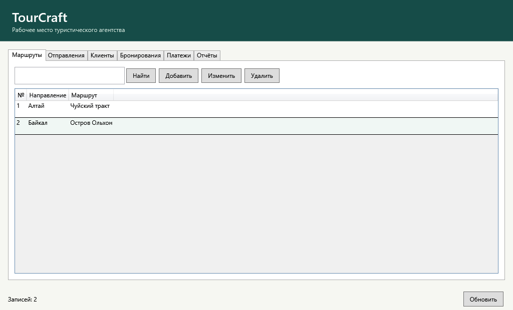
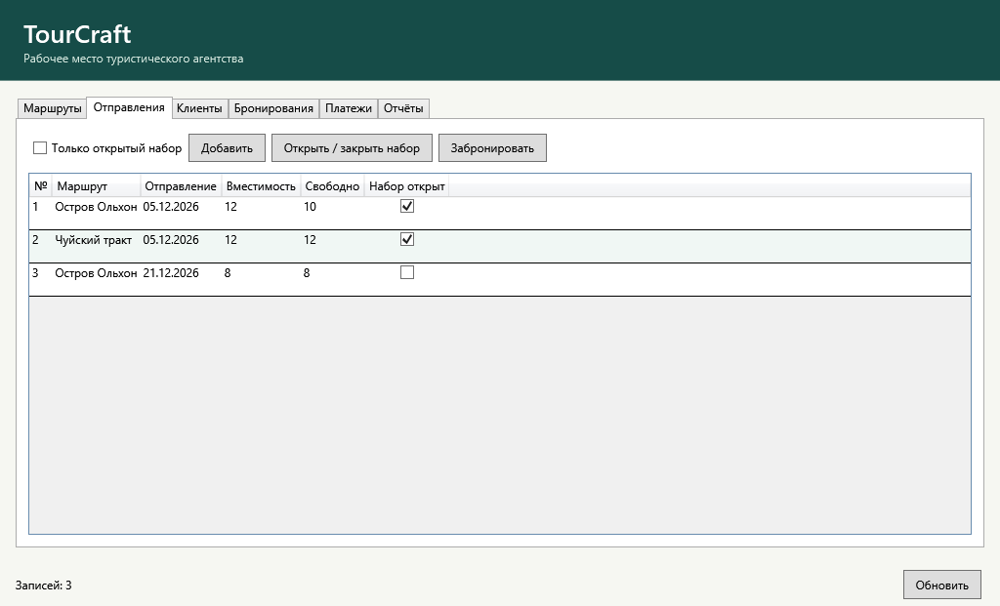
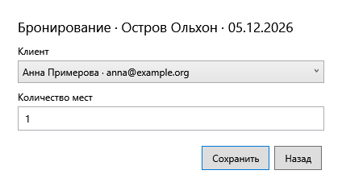
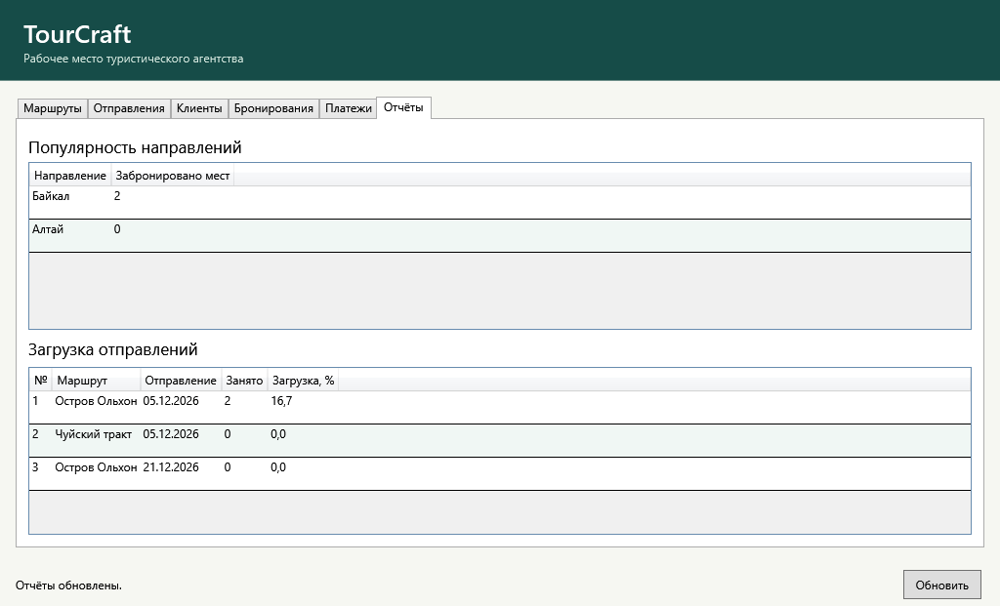

# TourCraft - туристическое агентство
Междисциплинарная проектная работа № 2. Настольная информационная система для сотрудника туристического агентства.

## Автор и тема
| Поле | Сведения |
| --- | --- |
| Тема | № 11. TourCraft - туристическое агентство |
| Срок | 27.10.2026 - 24.11.2026 |
| Формат | Индивидуальная работа |
| ФИО | Рощинина Милена Вячеславовна |
| Группа | 9/3-РПО-24/1 |

## Назначение системы
Сотрудник подбирает маршрут и дату, регистрирует клиента и бронирует места. Отмена возвращает места на конкретное отправление. Оформленные платежи сохраняются в истории.

## Реализованные возможности

| Возможность | Что может сделать сотрудник | Состояние |
| --- | --- | --- |
| Каталог маршрутов | Найти тур по названию или направлению, добавить или изменить маршрут, удалить маршрут без отправлений | Реализовано |
| Отправления | Назначить дату и вместимость, открыть или закрыть набор, отобрать открытые отправления | Реализовано |
| Клиенты | Зарегистрировать клиента и сохранить его контакт | Реализовано |
| Бронирования | Выбрать клиента и количество мест, оформить бронь или подтвердить отмену с возвратом мест | Реализовано |
| Платежи | Записать оплату и посмотреть историю с суммами и датами | Реализовано |
| Отчёты | Сравнить направления по числу забронированных мест и увидеть загрузку каждого отправления | Реализовано |

## Технологии и зависимости

| Компонент | Версия или сведения |
| --- | --- |
| Платформа | Windows, .NET 10 (`net10.0-windows`), сборка проверена с SDK 10.0.401 |
| Язык и интерфейс | C#, WPF, XAML |
| База данных | Microsoft SQL Server 2022 Express LocalDB |
| Доступ к данным | ADO.NET, Microsoft.Data.SqlClient 6.1.5 |

## Структура репозитория
- `src/TourCraft/` — проект, главное окно, формы ввода и доступ к данным.
- `database/` — создание схемы, тестовые данные и инструкция развёртывания.
- `docs/` — требования, ER-диаграмма и тестирование.
- `screenshots/` — изображения работающих экранов для демонстрации.

## Запуск на другом компьютере

### 1. Подготовка

Скачайте или клонируйте репозиторий. Установите .NET SDK 10 для Windows и SQL Server 2022 Express LocalDB. Откройте PowerShell в папке, где лежит этот README.

### 2. Развёртывание базы данных

При первом запуске создайте таблицы и загрузите учебные данные. Скрипт последовательно выполняет `schema.sql` и `seed.sql`. [Подробная инструкция](database/README.md)

```powershell
powershell.exe -NoProfile -ExecutionPolicy RemoteSigned -File .\database\Initialize-Database.ps1
```

### 3. Настройка подключения

По умолчанию приложение подключается к базе TourCraft в `(localdb)\MSSQLLocalDB` с учётной записью Windows. Для другого экземпляра задайте переменную окружения в том окне PowerShell, из которого будете запускать приложение. Пример для локального SQL Express:

   ```powershell
   $env:TOURCRAFT_CONNECTION = 'Server=.\SQLEXPRESS;Database=TourCraft;Integrated Security=True;Encrypt=True;TrustServerCertificate=True'
   ```

### 4. Запуск приложения

**В Visual Studio** выберите «Открыть проект или решение», откройте [TourCraft.csproj](src/TourCraft/TourCraft.csproj) и нажмите **F5**. Нужна версия Visual Studio с поддержкой .NET 10 и компонентом «Разработка классических приложений .NET».

**В PowerShell** выполните команду из корня проекта.

   ```powershell
   dotnet run --project src/TourCraft/TourCraft.csproj
   ```

При успешном подключении на вкладке «Маршруты» появятся «Остров Ольхон» и «Чуйский тракт». Чтобы проверить бронирование, выберите открытое отправление, нажмите «Забронировать», укажите клиента и одно место. После сохранения значение в столбце «Свободно» уменьшится на единицу.

## Бизнес-правила и транзакция
**BR-01.** Число мест в заявке положительно и укладывается в доступный остаток. **BR-02.** Бронь допускается при открытом наборе. **TX-01.** SQL Server одним условным обновлением проверяет набор и уменьшает остаток. Добавление брони входит в ту же транзакцию. При ошибке SQL Server откатывает изменения.

## Скриншоты
Каталог маршрутов



Даты отправлений, вместимость и статус набора



Оформление бронирования



Популярность направлений и загрузка отправлений



## Документация и проверка
[Требования](docs/requirements.md) · [Модель данных](docs/database-schema.md) · [Тестовые сценарии](docs/testing.md)

## Известные ограничения
У приложения одна роль сотрудника. Отмена брони сохраняет историю платежей. Финансовые возвраты оформляются вне системы.
