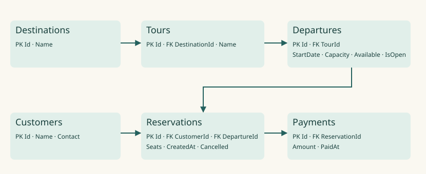

# Модель данных TourCraft
| Таблица | Назначение | Связи |
| --- | --- | --- |
| Destinations | Направление с уникальным названием | Направление содержит несколько туров |
| Tours | Название маршрута | Принадлежит направлению |
| Departures | Дата, вместимость, свободные места и признак открытого набора | Принадлежит туру |
| Customers | Имя и контакт клиента | Клиент может оформить несколько броней |
| Reservations | Количество мест, состояние и время оформления | Ссылается на отправление и клиента |
| Payments | Сумма и время платежа | Принадлежит брони |

Все таблицы имеют числовой первичный ключ Id. Внешние ключи препятствуют удалению используемых записей. Остаток находится между нулём и вместимостью. Количество мест брони и сумма платежа положительны. Отмена сохраняет запись и восстанавливает остаток в одной транзакции.

